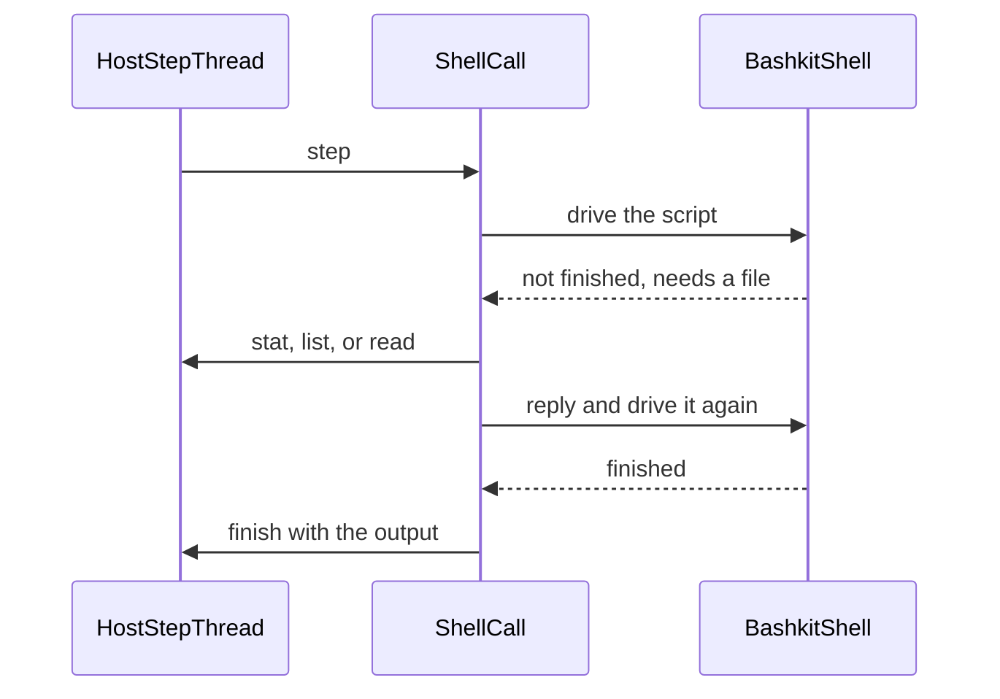

# Integrate bashkit into the bashkit Plugin and ship it with Workshop

## Staging

This is the first of two stages. It adds the Pack and the read-only file functions, so the Plugin can be tried out for a day or two and we learn what the integration involves. The second stage adds writing.

That fact decides any choice that comes up during the work:

- **A write just fails.** Nothing is built around the failure: no overlay, no scratch directory, no note added to results, and no effort on how each built-in words it.
- **A model that a failed write confuses a little is acceptable for now.**
- **Between two ways to do something, take the one with less code**, unless it would have to be thrown away to add writing.
- **Nothing is built for writing ahead of time.** The file request channel is where writes will go, as more kinds of request.
- **Bash runs inside the steps of its call for now.** Moving it to a thread of the Plugin's own comes later, together with a wake function in the contract. That change is confined to the function that runs one call.

## What changes

In `runvil-plugin-bashkit`, where [runvil-plugin-bashkit/crates/plugin-bashkit/src/lib.rs](runvil-plugin-bashkit/crates/plugin-bashkit/src/lib.rs) today loads, names itself `bashkit`, and inserts no Pack:

- The Plugin inserts the Pack `runvil/bash`, so a prompt declares `uses: [bash]`. The Plugin itself still reports the name `bashkit`.
- The Pack has one tool, id `bash/shell`, wire name `Shell`, defined by Cursor's Shell definition with recorded edits.
- Each run gets one bashkit shell session. Its working directory, variables, and functions carry over between calls.
- The shell reads the run's files through the contract's `stat`, `list`, and `read`, so the run's policy applies to every read.
- The shell cannot change files yet. A command that writes, deletes, or renames one fails, until the next stage adds writing.

In `runvil`:

- Workshop builds the Plugin's library with every build and ships it in its Plugin directory, beside std's.
- The built-in chat names `bash` under `uses:` and offers it in the Static Set.
- A switch, committed as off, mounts the C drive read-only in every run.

## Order of work

1. The Plugin is finished and verified in its own repository, in commits that each carry their tests.
2. Its `master` is pushed to `cppalliance/runvil-plugin-bashkit`. `runvil` pins the Plugin by commit, as it pins std's, so nothing in `runvil` can build against it before then.
3. `runvil` pins that commit and gains the three changes above, on a branch of its own. `origin/master` of `runvil` is the head of the open pull request 210, so a push there would add this work to that pull request. The branch starts from the local `master`, which holds that pull request's eight commits.
4. The branch is pushed to `origin`, and a pull request against `cppalliance/runvil` is opened last.

## Part 1: the Plugin

### Repository rules

The repository was set up from `runvil-plugin-api` before the std Plugin's repository got the rules `runvil` follows now. It takes them from the std Plugin's repository:

- **No file length limit.** A file holds one concept, and size limits sit on functions and types.
- **Function limits.** `clippy.toml` holds a function to 100 lines and 7 arguments, as it does today. Its text becomes the std Plugin's, which names the type-size check.
- **Type limits.** A new crate, `crates/build-checks`, is the std Plugin's copy of `runvil`'s type-size check: a type has at most 25 inherent methods, summed across every `impl` block in its crate, and a struct at most 12 named fields. `cargo test -p build-checks` runs it, so the workspace's test command and CI run it with no new step.
- **Lints.** The `[workspace.lints]` tables already match the std Plugin's. They gain `assert_is_empty = "allow"`, the one entry `runvil` has that they lack.
- **Docs.** The CI docs job gains `--document-private-items`, since almost every item is private.
- **`AGENTS.md`.** New, adapted from the std Plugin's, so the rules are written where the next change will read them.

### Where the script runs

In this stage bash runs inside the steps of its tool call, on the Host's thread. Each step drives the script until it finishes, needs a file, or waits on a timer.



- **Driving the script.** The call polls bashkit's future directly. A poll that comes back unfinished either left a file request, which the call serves and then polls again, or is waiting on a timer, which ends the step. After 32 file requests the step ends too, as Grep's does after 32 files.
- **Runtime.** bashkit's time limit and `sleep` use tokio timers, so `Bashkit` holds a tokio runtime with one worker, built in `load()`, whose only job is to run them. Each poll enters the runtime's context for its duration. Dropping the Plugin drops the runtime, which joins its thread, as the contract's unload rule requires.
- **File requests.** bashkit holds its file system as a `'static` `Arc<dyn FileSystem>`, so `RunFiles` cannot hold the call's borrowed `ToolCall`. Instead it sends each request over a channel and waits for the reply; the call takes the request, performs it with its `ToolCall`, and replies. A request with no call running fails. `RunFiles` is written to be used from any thread, which bashkit requires anyway, so it does not change when bash moves to its own thread.
- **Read-only.** `RunFiles` is the shell's whole file system, with no layer above it. Each of its methods that would change a file returns one fixed error, such as `the shell cannot change files in this build; it can only read the run's files`, and that is all the handling a write gets in this stage. Redirects to `/dev/null` still work, because bashkit handles them in its interpreter. The shell starts in `/`, the run's root.
- **Only the run's files.** bashkit's builder would add two layers over `RunFiles`, and both are turned off. Its root layout (`rootfs`) shows a made-up `/etc`, `/proc`, and `/usr/bin` that no other tool of the run could see. Its link following resolves every component of every path with extra `stat` calls and reads link targets, which the contract does not report; the Host follows links itself when it reads.
- **Limits.** bashkit's own limits bound each command: 30 seconds, 10,000 commands, 10,000 iterations of a loop, and 1 MiB of each output stream. Its limits for a whole session are lifted, because they would stop a run's shell for good after 1,000 calls. `RunFiles` refuses to read a file over 16 MiB, the ceiling the std tools have.
- **One script at a time.** Calls of one Pack instance may arrive together, since the Engine issues a round's calls at once. The session sits in a slot: a call takes the shell out and puts it back when it ends, and a call that finds the slot empty ends its step and looks again on the next.
- **Abandoned calls.** When the Host drops a call, bashkit's future drops with it, which stops the script. The shell it had taken is gone, so the next call builds a fresh one, as bashkit's own `ExecutionHandle` does.

### The tool definition

`schemas/shell.json` holds Cursor's Shell definition, snapshot 2026-11-12 from a Cursor agent session's tool list. `schemas/EDITS.md` records each edit and its reason, in the form `runvil-plugin-std` uses. The edited description:

```text
Executes a given command in a shell session with an optional time limit.

The shell is a bash interpreter that runs inside the run. Its commands are built in: there are no external programs such as git, npm, or docker, and no network.

- The session lasts for the run: the working directory, variables, and functions carry over from one call to the next.
- The shell reads the run's files. It cannot change them yet: a command that writes, deletes, or renames a file fails.
- Output past {output_cap} characters is cut in the middle: the result keeps the start and the end and says so.
- Calls share the one session and run one at a time. Chain dependent commands with `&&`.
```

- **Removed from the description:** the line about git, npm, and docker; the bullets naming `Grep`, `Glob`, `Read`, `rg`, and `gh`; the terminal-file line; the advice to run parallel Shell calls.
- **`command`, `working_directory`, `description`:** Cursor's text, unchanged. `description` is accepted and unused.
- **`block_until_ms`:** becomes a time limit that stops the command, because the shell has no background. It is an integer of at least 1, defaults to `{timeout_ms}` (30000), and a larger value is lowered to that.
- **Removed parameters:** `notify_on_output`, `request_smart_mode_approval`, `smart_mode_block_reason`.

Placeholders are filled from the constants the code enforces, as in `std`.

### Results

- A finished command returns untrusted text in Cursor's shape: an `Exit code:` line, then stdout followed by stderr in one fenced block. A nonzero exit code is still a result.
- Output over 20,000 characters keeps its first 10,000 and its last 10,000, which is what Cursor shows a model. The start holds the command's first lines and the end holds the error.
- A command that bashkit fails (syntax error, resource limit) is a `ToolError` of kind `Backend` with bashkit's message.
- A command that runs past its time limit fails with a message that says it was stopped and that the session is still usable. The research warns that a timeout reported as a bare failure invites a blind retry.
- Arguments parse with serde into a struct that denies unknown fields; a mismatch is `InvalidArguments`.
- A Host file error reaches the script as an I/O error with the Host's text, so a denied read shows the policy's reason on stderr.
- A refused change is an ordinary result: the command fails with a nonzero exit code and whatever bashkit prints for the error, and the script goes on as bash would.

### Files

All under [runvil-plugin-bashkit/crates/plugin-bashkit](runvil-plugin-bashkit/crates/plugin-bashkit):

- `Cargo.toml`: the dependencies below; crate types `cdylib` and `rlib`; a `dll` feature, on by default, that gates `export_plugin!`. The last two are what `plugin-std` has, so that Workshop can link the Plugin and export its entry point under a file name of its own.
- `src/lib.rs`: `Bashkit` gains the runtime and the parsed definition, `PACKS`, and `new_pack`.
- `src/pack.rs`: `BashPack`, its `PackInfo`, and its tool list.
- `src/spec.rs`: the definition read from `schemas/shell.json`.
- `src/shell.rs`: the arguments, one call's step loop, and the result text.
- `src/session.rs`: one run's shell session.
- `src/files.rs`: `RunFiles`, the request type, serving a request from a `ToolCall`, and the refusal of changes.
- `schemas/shell.json`, `schemas/EDITS.md`.

```toml
bashkit = { version = "0.21", default-features = false, features = ["jq"] }
tokio = { version = "1", features = ["rt-multi-thread", "sync", "time"] }
serde = { version = "1", features = ["derive"] }
serde_json = "1"
```

bashkit's network, real file system, Python, SQLite, and TypeScript features stay off: every file operation must go through the Host, and the `web` Pack owns fetching.

### Tests

Unit tests in the crate, through the SDK's `testing` fake Host and its `Files` tree:

- The Plugin inserts `runvil/bash` with one tool, `shell`, wire name `Shell`.
- `echo` returns its output and exit code 0; `false` returns exit code 1.
- A variable and a `cd` from one call are seen by the next.
- `cat` and `ls` see a file of the run; a denied read shows the policy's reason.
- A redirect to a file fails with a nonzero exit code.
- `block_until_ms` stops `sleep`, and the session still works afterward.
- Dropping a call during `sleep` leaves the next call working, with variables gone.
- Missing `command`, an unknown key, and `block_until_ms: 0` are refused.
- Output past the cap keeps its start and its end and says so.
- The Plugin unloads with `RV_OK` after calls have run.

## Part 2: Workshop

All in the `runvil` repository.

### Shipping the library

Workshop ships std's library by linking the Plugin into a small crate of its own, which exports the entry point under a fixed file name; the server depends on that crate so Cargo builds the library with every build. bashkit's follows the same path, and each place that handles std's one library handles two:

- [runvil/Cargo.toml](runvil/Cargo.toml): the Plugin pinned by commit, the new crate, and its workspace membership. The key is `bashkit-plugin` for the reason std's is `std-plugin`: the Plugin's own library already has the name of the file Workshop ships. The Plugin already pins the contract at `03a9fa3`, the commit `runvil` pins.

```toml
bashkit-plugin = { package = "plugin-bashkit", version = "0.1.0", git = "https://github.com/cppalliance/runvil-plugin-bashkit", rev = "<the pushed commit>", default-features = false }
workshop-plugin-bashkit = { path = "crates/workshop/plugin-bashkit" }
```

- `crates/workshop/plugin-bashkit`, new: [runvil/crates/workshop/plugin-std](runvil/crates/workshop/plugin-std) with the names changed. Its library is named `plugin_bashkit`, and its one line is `runvil_plugin_sdk::export_plugin!(bashkit_plugin::Bashkit);`.
- [runvil/crates/workshop/server/Cargo.toml](runvil/crates/workshop/server/Cargo.toml): depends on the new crate.
- [runvil/crates/build-xtask/src/tidy.rs](runvil/crates/build-xtask/src/tidy.rs): the `PLUGINS` tier gains the crate, and its test with it.
- [runvil/crates/build-workshop/src/main/plugin.rs](runvil/crates/build-workshop/src/main/plugin.rs): `library_name`, `built_library`, `bundle_config`, `check_bundled`, and `place` each handle the one std library. They take the list of shipped libraries instead, and their callers in `pipeline.rs` and `installer.rs` and their tests follow.
- [runvil/crates/workshop/desktop/installer.nsi](runvil/crates/workshop/desktop/installer.nsi): the install, decline, and uninstall lines for `plugins\plugin_std.dll` gain a twin for `plugins\plugin_bashkit.dll`.
- [runvil/.github/workflows/installers.yml](runvil/.github/workflows/installers.yml): the path filter gains the new crate.
- [runvil/deny.toml](runvil/deny.toml): `allow-git` gains the Plugin's repository. The license allowlist gains `bzip2-1.0.6`, with a comment naming the one crate that needs it. bashkit depends on `bzip2` 0.6.1, which is `MIT OR Apache-2.0` itself but by default pulls `libbz2-rs-sys`, the Rust port of bzip2, whose license is `bzip2-1.0.6`, a permissive BSD-style license. bashkit turns that default on, so the port cannot be avoided from outside.
- Test Plugin directories: `plugin_dir` in `crates/workshop/server/src/agents/tests.rs` and `std_plugin_dir` in `crates/workshop/server/tests/common/mod.rs` hold std's library alone. They hold both, because the built-in chat will require both.

### The built-in chat

[runvil/crates/workshop/agents/agents/chat.md](runvil/crates/workshop/agents/agents/chat.md) names the Pack and offers it:

```yaml
uses: [user, std, bash, web]
```

```lua
tools.offer("std")
tools.offer("bash")
tools.offer("web")
tools.offer(tools.packs.extras())
```

The `uses:` list is written on one line, in the form the repository's tests use, in place of the block list the file has today.

A Pack named under `uses:` is required, so a Workshop whose Plugin directory lacks the bashkit library refuses the chat prompt, as it does today without std's. That is why the library ships. Tests that pin the chat's Packs or its tool list gain `bash` and `Shell`.

### The C drive switch

So the shell has real files to read during the trial.

[runvil/crates/workshop/server/src/agents/language_guide.rs](runvil/crates/workshop/server/src/agents/language_guide.rs) already holds one switch, `ENABLED`, which mounts the language guide read-only in every run. A second constant goes beside it and uses the same `mount_at`:

```rust
/// The switch: `true` mounts this machine's whole C drive, read-only, in
/// every run at [`C_DRIVE_MOUNT`], for trying the shell on real files.
/// Committed as `false`: while it is on, a model can read every file
/// this user can.
const C_DRIVE: bool = false;
const C_DRIVE_SOURCE: &str = r"C:\";
const C_DRIVE_MOUNT: &str = "/c";

pub(super) fn run_vfs() -> VfsRef {
    let mut vfs = VfsRef::default();
    if ENABLED {
        vfs = mount_at(vfs, MOUNT, Path::new(SOURCE));
    }
    if C_DRIVE {
        vfs = mount_at(vfs, C_DRIVE_MOUNT, Path::new(C_DRIVE_SOURCE));
    }
    vfs
}
```

- **Mount point.** `C:\Users\Vinnie` is `/c/Users/Vinnie` in a run, the path Git Bash uses. The in-memory root stays at `/` and stays the store.
- **Read-only.** `mount_at` already mounts with `Writability::ReadOnly`, so the `std` tools and, later, the shell's writes are refused there by the file system itself.
- **Both switches may be on.** `VfsRef::overlay` keeps the store declaration and stacks, so the two mounts sit side by side. One new test maps two temporary directories and reads both; the existing tests cover the rest of `mount_at`.
- **Off anywhere but this machine.** On a system with no `C:\`, `mount_at` logs a warning and leaves the run its plain root, as it does today for a missing guide.
- **Docs.** The module docs of `language_guide.rs` and the paragraph in [runvil/crates/workshop/server/src/agents.rs](runvil/crates/workshop/server/src/agents.rs) that describes a run's file system name the second switch.

While the switch is on, every run, and so the model's provider, can read any file this user can, and a search that starts at `/` walks the whole drive.

### Trying it

1. Set `C_DRIVE` to `true`.
2. Build Workshop with `cargo workshop --release`, which builds both libraries and places them in `plugins` beside Workshop.
3. Open a chat and ask the model to run `ls /c/Users`.

## Research in the workspace

- [runvil-design/specs/cursor/agent-file-tools.md](runvil-design/specs/cursor/agent-file-tools.md), section "Shell" (line 3689): how Cursor's shell behaves, read from its bundle. The source of the output rule and the time-limit wording above. It holds no copy of the definition's text, so `shell.json` is taken from a Cursor session's tool list.
- [runvil-design/research/2026-09/2026-09-20-terminals-pty-substrate.md](runvil-design/research/2026-09/2026-09-20-terminals-pty-substrate.md), section 5: bashkit as the agent's shell. It reached the same feature set, `default-features = false` plus `jq`, and shows that bashkit's `git` feature is a facade that must stay off.
- [runvil-design/specs/cursor/master-delete.md](runvil-design/specs/cursor/master-delete.md), Table 1: what a shell `rm` costs next to a typed tool. For the writing stage.

## Known limits

- **A heavy script holds its step.** bashkit never pauses during CPU-bound work, so a slow script freezes its run, and the Stop button with it, until the script ends or hits bashkit's command and loop limits. This stage accepts that.
- **Idle polling during a wait.** Contract 0.4 has no wake function, so while a script sits in a bash `sleep`, or a call waits for the session, the Host keeps stepping with nothing to do.
- **Both go away later.** Running bash on a thread of the Plugin's own, with a wake function in the contract, keeps every step short and removes the empty steps. The trial will show how much either one matters.
- **No writes, so no scratch files.** A script that writes a temporary file fails. This stage accepts that, and whatever else turns out to need writable files is what the trial is for.
- **Workshop's build and installers grow.** bashkit and its dependencies join every Workshop build, and its library joins every installer.
- **Unverified until built.** Nothing was built during planning, so these are expectations:
  - bashkit compiles with `default-features = false` plus `jq`.
  - Its timers fire when its future is polled from the Host's thread with the runtime's context entered.
  - `RealBackend::rooted` accepts a drive root such as `C:\`.
  - bashkit's dependency tree passes `cargo deny check` and `cargo audit` in `runvil` once `bzip2-1.0.6` is allowed. Any other license it needs is added only when it is permissive, and the pull request names it.

## Out of scope

- Writing. It is the next stage: write functions in the contract (`runvil-plugin-api` and the loader in `runvil`), and each refusal here becoming a real write through the Host.
- The pages in `runvil-docs` and `runvil-design` that list the Packs Workshop ships.
